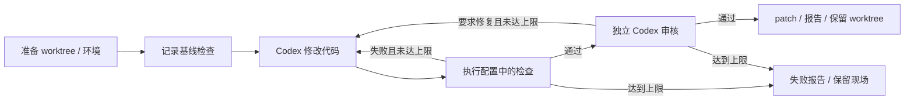

# LangGraph Agents

面向单人本地开发的 TypeScript 编排工具。注册多个 Git 仓库后，由真实 Codex coding agent 在独立 worktree 中修改代码，运行检查，根据失败日志修复，再交给独立只读会话审核。LangGraph 和 SQLite 保存进度，可退出进程后恢复。



## 准备

需要 Node.js >= 22.9、Git 和已登录的 Codex CLI。CLI 必须支持 `exec --json`、`--output-schema`、`--ignore-user-config` 和 `exec resume`。本机验证环境：Windows、Node 24.19.0、Codex CLI 0.163.0-alpha.11.2。

```powershell
cd D:\github\langgraph-agents
npm ci
npm run build
codex --version
codex login status
node dist/cli.js --help
```

首次使用 Codex 需自行完成 `codex login`。Windows 需要已完成 Codex 原生 `elevated` 沙箱初始化；这里的 `elevated` 指初始化方式，agent 命令仍以受限身份执行。工具显式启用该后端，不自动修改系统配置。参见 [Windows 沙箱文档](https://learn.chatgpt.com/docs/windows/windows-sandbox)。其他平台使用 Codex 的默认沙箱实现。

适配器使用官方 [非交互 JSONL 协议](https://learn.chatgpt.com/docs/non-interactive-mode)，直接管理子进程以支持暂停和超时清理。它保留 Codex 登录，忽略用户 `config.toml` 中的模型、MCP 和插件配置，显式传入工作区权限；用户和项目的执行策略仍生效。自定义 provider 暂不支持。可用 `CODEX_BIN` 指定 Codex 可执行文件路径。

## 注册仓库

为项目准备 JSON 配置，按实际项目修改命令；模型不能改变任务保存的命令配置。

```json
{
  "setup": [
    { "name": "install", "command": "npm", "args": ["ci"], "timeoutMs": 600000 }
  ],
  "checks": [
    { "name": "typecheck", "command": "npm", "args": ["run", "typecheck"] },
    { "name": "test", "command": "npm", "args": ["test"], "timeoutMs": 300000 }
  ],
  "rules": ["AGENTS.md"]
}
```

```powershell
node dist/cli.js projects add frontend --repo D:\repos\frontend --config .\frontend.json
node dist/cli.js projects add backend --repo D:\repos\backend --config .\backend.json
node dist/cli.js projects list
```

无安装步骤可省略 `setup`。`checks` 至少一项且名称唯一，执行文件与参数分开写，不使用 `&&` 拼接。命令 `cwd` 默认为 `.`，必须是仓库内相对路径。`rules` 可列多个规则文件，缺失文件跳过。可设置 `model` 为账号可用模型；省略时使用 Codex 内置默认模型。

重复注册同一 id 更新配置，已有任务继续使用其配置快照。RN、Web、后端和工具库都使用相同接口，只需各自配置命令。原生构建依赖和真机验收需在相应平台准备；CLI 检查通过不代表真机行为已经验证。

## 执行与恢复

源仓库必须有提交且工作区干净。任务固定当前 HEAD，不复制未提交修改、被忽略文件、密钥或 `node_modules`。首版不支持 submodule。

```powershell
node dist/cli.js run frontend --task "修复搜索请求乱序覆盖结果的问题，补充回归测试"
node dist/cli.js runs
node dist/cli.js status <run-id>
node dist/cli.js resume <run-id>
```

默认数据目录为启动目录的 `.orchestrator`。建议从工具根目录运行，或给所有命令传相同的 `--data-dir D:\agent-data`。同一数据目录串行运行一个任务；注册多个仓库不等于并行调度。一个任务只处理一个仓库，不处理跨仓库事务。

| 参数                 | 默认值 | 含义                                                  |
| -------------------- | ------ | ----------------------------------------------------- |
| `--max-attempts`     | 3      | 首次编码与修复的总轮数，1–10                          |
| `--max-agent-calls`  | 10     | 编码和审核的总调用预算，1–30；失败调用也计入          |
| `--agent-timeout-ms` | 600000 | 每次 agent 调用超时                                   |
| `--pause-after`      | 无     | 在 prepare / baseline / code / verify / review 后暂停 |

预算在创建时固定，`resume` 不接受覆盖。调用次数与超时不是精确费用上限；Codex 返回的 token usage 另存于 SQLite。

运行中按 Ctrl+C，或在另一个终端执行 `node dist/cli.js pause <run-id>`。编排器终止当前子进程树，等待退出后保存暂停状态并释放锁，然后可 `resume`。

```powershell
node dist/cli.js run frontend --task "你的开发任务" --pause-after code
# 程序退出后启动新进程，继续验证和审核
node dist/cli.js resume <run-id>
```

| 状态                | 含义                                                     |
| ------------------- | -------------------------------------------------------- |
| `ready` / `running` | 已创建 / 执行中                                          |
| `paused`            | 暂停，可恢复                                             |
| `blocked`           | 权限、环境、进程、输出格式或预算等问题；处理原因后可恢复 |
| `succeeded`         | 配置检查与独立审核通过，交付时 diff 与验证一致           |
| `failed`            | 修复轮数耗尽，保留失败报告                               |

终态 `succeeded` / `failed` 的 `resume` 只返回状态，不重复执行。退出码：0 成功或查询、1 错误或 blocked、2 failed、3 paused。直接运行 `node dist/cli.js` 可取得原始退出码。

## 交付与数据

```text
.orchestrator/
  state.sqlite             项目、任务、阶段结果、会话、LangGraph 检查点
  worktrees/<run-id>/       独立分支及工作区修改
  runs/<run-id>/
    *.log                  基线、检查及 Codex 事件日志
    *.reply.json           agent 结构化结果
    changes.patch          完成或轮数耗尽时的差异，含新增文件
    report.json / report.md
```

任务打印 worktree 和产物绝对路径。用 `git -C <worktree> diff HEAD` 审阅，确认后自行提交、合并或应用 patch。快照把新文件标记为 intent-to-add 以纳入 diff，不创建提交。工作区的源提交和分支须保持原状；发现被提交、重置或切换分支会阻止继续交付。

工作完成后可自行用 Git `worktree remove` 清理不再需要的工作区；工具不会自动删除失败现场。备份时先暂停任务、停止执行进程，再复制整个数据目录。SQLite、日志及 patch 含任务、源码和模型输出，按本地项目数据管理。

## 恢复与权限边界

- 已完成节点、检查和 agent 结果有持久化记录，恢复不重复完成动作。成功 setup 复用，失败 setup 可重试并保留各次日志。
- 若文件修改后、结果保存前进程崩溃，会重试未完成动作。编码继续原会话并要求核对现有文件。setup/check 必须可安全重试；不承诺外部副作用恰好执行一次。
- 验证与 diff hash 绑定，审核和交付拒绝变更后的源码。完成的检查会复用，因此恢复时依赖、环境和外部服务须保持一致；环境变化应创建新任务重新验证。
- 同一数据目录有进程锁，旧进程死亡后可接管。记录的子进程仍活跃时先阻止恢复，避免同时写文件。PID 复用可能导致保守阻止。
- 编码使用 `workspace-write`，审核使用 `read-only`，禁止申请提权，工具网络关闭。只读不等于保密隔离，沙箱仍可能读取工作区外允许的文件。
- setup/check 是你配置的可信本机命令，在主机权限下执行，可以访问网络和本机环境。worktree 提供工作区分离，不是虚拟机；不要处理恶意仓库。agent 削弱检查脚本的风险由 diff 审核辅助识别，不能保证发现所有规避行为。

这是单机开发工具首版，不包含团队权限、队列服务、远程沙箱、密钥托管、完整审计平台或自动发布。

## 开发验证

```powershell
npm run typecheck
npm test
npm run lint
npm run build
```

自动化测试使用临时 Git 仓库、真实命令、SQLite 和独立进程；agent 使用可控替身，不消耗模型额度。真实 Codex 证据另见 `VALIDATION.md`。接口在 `src/domain.ts`，流程在 `src/workflow.ts`，Codex 适配器在 `src/codex.ts`，不含具体业务项目逻辑。

持久化采用 [LangGraph persistence](https://docs.langchain.com/oss/javascript/langgraph/persistence) 和官方 SQLite checkpointer。状态格式仍处于 0.x 阶段，升级前保留备份，不支持旧文本原型的数据迁移。
