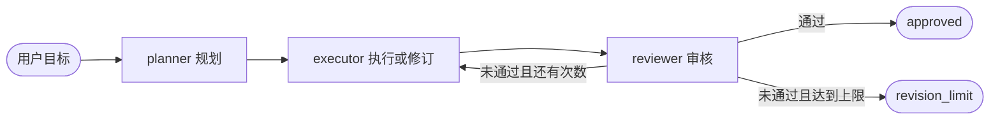

# LangGraph Agents

TypeScript + LangGraph 的可运行 agent 编排基础。三个角色共享类型化状态：planner 制定计划，executor 产出文本，reviewer 决定通过或给出修订意见。角色实现可替换，流程路由和执行次数上限由代码控制。



## 快速运行

需要 **Node.js >= 22.9**（本机使用 Node.js 24.19.0 验证）。

```powershell
cd D:\github\langgraph-agents
npm ci
npm run demo -- "设计一个任务管理系统"
```

离线演示不需要密钥，使用模拟角色运行真实 LangGraph。它会经历一次退回、一次修订，再审核通过。输出明确标记为模拟文本，仅用于演示流程。也可省略目标运行 `npm run demo`。

## 接入真实模型

```powershell
Copy-Item .env.example .env
# 编辑 .env，填入你的 API Key 和可访问的模型名称
npm run dev -- "设计一个任务管理系统，给出范围、数据结构和验收标准"
```

| 环境变量          | 含义                                                                                   |
| ----------------- | -------------------------------------------------------------------------------------- |
| `OPENAI_API_KEY`  | 必填；服务商提供的 API Key                                                             |
| `OPENAI_MODEL`    | 必填；你拥有访问权限、支持 tool calling 的模型名称                                     |
| `OPENAI_BASE_URL` | 可选；OpenAI 兼容接口的 API 根地址，通常以 `/v1` 结尾；留空使用 SDK 的 OpenAI 默认地址 |

模型适配器使用 **Chat Completions + tool calling** 返回 Zod 校验的计划、文本和审核结果。兼容服务需要支持 `tools`、指定 `tool_choice` 以及 OpenAI 格式的 `tool_calls` 返回值。只兼容普通聊天的接口无法使用此模式。Azure OpenAI 等不同鉴权协议需要自行更换模型适配器。

`.env` 不进入版本控制。每次模型请求超时 60 秒，SDK 最多重试 2 次；业务修订次数单独限制。不会把真实调用失败自动切换成模拟成功。

```powershell
# 默认 3 次，包含首次执行；可设 1–5 次
npm run dev -- --max-attempts 2 "你的目标"

# 编译后运行
npm run build
npm start -- "你的目标"

# 编译产物也支持离线运行
npm start -- --demo "你的目标"
```

CLI 输出已完成的节点、终止状态、执行次数、审核意见和最终文本。

| 退出码 | 结果                                                                        |
| ------ | --------------------------------------------------------------------------- |
| `0`    | 审核通过，状态为 `approved`                                                 |
| `1`    | 输入、配置、模型请求或输出校验失败                                          |
| `2`    | 达到执行次数上限仍未通过，状态为 `revision_limit`；保留最后一稿和反馈供检查 |

## 作为模块使用

在本项目中新增脚本时：

```typescript
import { createAgentGraph, createDemoAgents } from "./src/index.js";

const graph = createAgentGraph(createDemoAgents(), { maxAttempts: 3 });
const result = await graph.invoke({ goal: "设计一个任务管理系统" });
console.log(result.status, result.draft, result.feedback);
```

使用 `createOpenAIAgents(loadModelConfig())` 接入环境变量配置的模型；使用 `createModelAgents(chatOpenAI)` 注入已配置的模型实例。程序化调用时由调用方加载环境变量，导入模块不会自动读取 `.env`。

`createAgentGraph` 接收 `Agents` 接口，可以替换某个角色：

```typescript
import { createAgentGraph, createDemoAgents } from "./src/index.js";

const agents = createDemoAgents();
const graph = createAgentGraph({
  ...agents,
  review: async ({ draft }) => ({
    approved: draft.includes("验收标准"),
    feedback: "成果需要包含验收标准。",
  }),
});
```

- `plan(goal, config)` 返回 `{ steps: string[] }`。
- `execute({ goal, plan, draft, feedback }, config)` 返回 `{ draft: string }`。
- `review({ goal, plan, draft }, config)` 返回 `{ approved: boolean, feedback: string }`。

图节点把 LangChain 的运行配置传给角色。可以通过 `graph.invoke(input, { signal })` 传入取消信号；自定义角色也应把配置传递给实际模型调用。使用原生 `graph.stream(input, { streamMode: "updates" })` 可订阅节点更新。

每次调用从新状态开始。当前未配置 checkpointer，**不提供跨进程持久化、暂停恢复或对话记忆**。

## 项目结构

```text
src/
  contracts.ts     角色契约与边界校验
  graph.ts         状态、节点、条件路由和终止逻辑
  config.ts        模型环境配置
  agents/model.ts  三个真实模型角色
  agents/demo.ts   确定性离线示例
  cli.ts           命令行入口
  index.ts         供程序化使用的导出
tests/             图行为、CLI、配置和模拟传输测试
SPEC.md            项目范围、验收条件和实施依据
```

## 开发与验证

```powershell
npm run typecheck
npm test
npm run lint
npm run build
```

`npm run format` 自动整理格式与导入。依赖版本由 `package-lock.json` 锁定。

测试运行真实 LangGraph，模型层测试通过替换 HTTP 传输模拟供应商响应，不访问模型服务。覆盖首次通过、修订反馈、上限退出、非法数据、模型异常、独立运行、CLI 和配置校验。真实模型可用性、输出质量和供应商兼容性仍需配置凭据后实际验证。

首版 executor 只生成文本，没有 shell、文件写入、搜索或其他外部动作工具；模型审核结论也不等同于事实核查或软件测试。

## 官方参考

- [Graph API：状态、节点与条件边](https://docs.langchain.com/oss/javascript/langgraph/graph-api)
- [Workflows and agents](https://docs.langchain.com/oss/javascript/langgraph/workflows-agents)
- [ChatOpenAI 集成](https://docs.langchain.com/oss/javascript/integrations/chat/openai)
- [ChatOpenAI API：结构化输出](https://reference.langchain.com/javascript/langchain-openai/ChatOpenAI)
